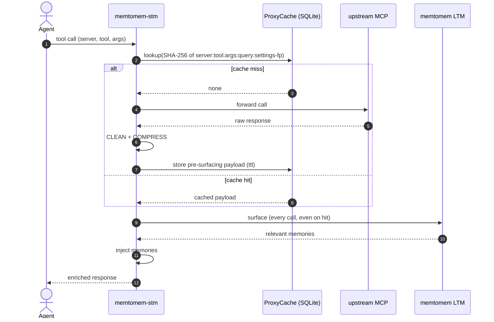

# Response Caching

For the file-backed schema and configuration-source boundary, see the
[Proxy Configuration Reference](reference/proxy-config.md).

## Response Cache

Proxied tool responses are cached in SQLite to avoid repeated upstream calls:



The key insight: **the cache stores pre-surfacing content**. Surfacing runs on every cache hit so injected memories stay fresh even when the upstream payload was cached hours ago.

```json
{
  "cache": {
    "enabled": true,
    "db_path": "~/.memtomem/proxy_cache.db",
    "default_ttl_seconds": 3600,
    "max_entries": 10000,
    "tool_annotation_policy": "conservative"
  }
}
```

Key details:

- Cache key = SHA-256 over length-framed `server`, `tool`, `args` (argument order independent), the call's `_context_query`, and an opaque fingerprint of the active upstream connection plus the settings that shape or admit the stored body — the resolved per-tool compression settings plus the `min_result_retention`, `max_upstream_chars`, `max_upstream_bytes`, and `relevance_scorer` globals. Length framing prevents component-boundary collisions. The stored body is the *shaped + compressed* response — compression is query-aware (BM25 relevance budgets) and config-dependent — so the same tool+args under a different query context, or after a shaping/compression/admission-setting change (hot reload included), gets its own entry instead of being served a body produced for someone else's query or under old settings. The flip side: callers that pass a different `_context_query` on every call re-fetch instead of hitting the cache.
- **Key-schema upgrades purge the cache once** — rows written under an older key derivation are unreachable by any new lookup, so on first start after an upgrade that changes the key shape the cache is emptied (tracked via SQLite `user_version`). One-time cold start; entries repopulate on use.
- **Connection isolation** — URL, headers/credentials, transport, and active stdio command/arguments/environment changes use a different cache identity. A failed live reconnect may still return a response from the old connection, but that fallback is never stored under the new identity. Connection field values are not persisted in the key or envelope.
- **Pre-surfacing content is cached** — surfacing is re-applied on cache hit, using the stored pre-compression cleaned length for its size gate.
- **Mutating tools are not cached** — the cache is on by default for *every* tool of *every* upstream, so without a gate a write tool (`create_*` / `send_*` / `write_*` / `delete_*`) called twice with identical args within the TTL would be served the first call's cached success *without re-executing the side effect*. The `tool_annotation_policy` gates eligibility on the upstream tool's MCP annotations (`readOnlyHint` / `destructiveHint`):
  - `conservative` (default) — cache everything except tools that self-declare as writers (`readOnlyHint: false` or `destructiveHint: true`). Keeps caching for read-only and un-annotated tools. A tool declaring *both* `readOnlyHint: true` and `destructiveHint: true` is contradictory and is deliberately treated as a writer — the MCP spec scopes `destructiveHint` to `readOnlyHint: false` tools, but distrusting a self-contradiction only costs a cache slot, while trusting it could replay a side effect; use a per-tool `cache: true` to opt such a tool back in.
  - `strict` — cache only tools that explicitly declare `readOnlyHint: true` (un-annotated tools default to may-mutate per the MCP spec).
  - `ignore` — pre-gate behavior; cache every tool regardless of annotations.

  **New config files are created with an explicit `"tool_annotation_policy": "strict"`** — `mms init`, `mms add` (when no config exists yet), and `mms add --from-clients` all write it. The schema default stays `conservative` so an existing config without the key keeps its behavior; loading such a file (and `mms config validate`) emits a one-line advisory pointing at the migration. Under `strict`, the per-tool / per-server `cache: true` override below is the **allowlist**: it opts a known-read-only tool whose upstream omits annotations back into caching.
- **Annotations stay fresh at runtime** — the proxy subscribes to `notifications/tools/list_changed` on every upstream session. When an upstream re-declares its tools mid-connection, the advertised snapshot is re-fetched and any tool whose eligibility flipped toward may-mutate — or that disappeared from the list — has its existing cache rows invalidated, so a pre-flip row can't be served after the flip (or once the annotations move back). Explicit `cache` overrides still win: a tool forced in with `cache: true` is never auto-invalidated. Upstreams that change annotations *without* emitting `list_changed` are picked up on the next reconnect, as before.
- **Per-tool / per-server cache override** — set `cache: true|false` on a `tool_overrides` entry or on an `UpstreamServerConfig` to force a tool/server in or out of the cache, overriding the annotation policy (precedence: tool > server > policy). Use `cache: false` for a volatile read tool or a writer on an upstream that omits annotations; `cache: true` to re-enable caching for a tool an upstream mis-annotates — under the `strict` policy this is the supported allowlist for un-annotated read-only tools (no separate allowlist setting exists).
- **Per-tool / per-server TTL override** — set `cache_ttl_seconds` on a `tool_overrides` entry or on an `UpstreamServerConfig` to override how long that tool's/server's responses stay cached, independent of the on/off `cache` gate (precedence: tool > server > global `cache.default_ttl_seconds`). `null` (default) inherits the next level down — at the tool/server level `null` means *inherit*, not *never expires*. A positive value sets the TTL in seconds; `0` disables caching for that tool/server — while the resolved TTL is `≤ 0` the lookup is bypassed, so a stale row is never served (mirroring a global `default_ttl_seconds` of 0); existing on-disk rows are then cleaned up opportunistically (the next identical call invalidates the row regardless of its response shape — text, non-text, mixed, error, or empty). `cache: false` still wins outright, and `cache: true` with `cache_ttl_seconds: 0` is eligible-but-TTL-disabled, i.e. effectively off.
- **Envelope-aware successful text responses** — cache schema v6 stores the compressed text, pre-compression cleaned length, JSON-safe `structuredContent`, result-level `_meta`, and single text-block metadata (`annotations` and block `_meta`). Cache hits reconstruct the same metadata. Upgrading from v5 discards only response-cache rows; metrics and feedback remain intact. Privacy scanning covers both text and envelope JSON. Multiple text blocks carrying metadata retain their boundaries and bypass compression, surfacing, indexing, extraction, and caching; each block is cleaned on its own and their text is capped at the tool's compression budget instead (see below). Errors and non-text/mixed content remain uncached; malformed, non-JSON-safe, or unmarked out-of-band rows are never served.
- **Privacy exclusion** — responses that look like secrets are never persisted to the cache; see [SECURITY.md](../SECURITY.md). The check reads through JSON string escaping (up to three levels of JSON inside a JSON string; text that still decodes further counts as sensitive), so a false positive costs one uncached response. This guard always applies on top of the policy/override above.
- **Transient-key exclusion** — to prevent serving expired progressive/selective keys on a cache hit (which would drop the response tail), the cache automatically skips storing any response carrying a transient-key marker (like a `PROGRESSIVE_FOOTER_TOKEN` or a `selection_key` JSON field). The next identical call re-runs the pipeline to generate live keys.
- Expired entries are purged on startup; oldest entries evicted when `max_entries` is exceeded
- Clear cache via MCP tool: `stm_admin(action="proxy_cache_clear", params={"server": "gh", "tool": "search_code"})` clears matching response-cache entries; an unfiltered `stm_admin(action="proxy_cache_clear")` flushes the entire response cache **and** the in-memory surfacing result cache
- TTL defaults to global (`cache.default_ttl_seconds`) but is overridable per-tool / per-server via `cache_ttl_seconds` (see above); `tool_overrides` additionally tune compression, sizing, and cache eligibility (`cache: true|false`)

### Annotated text-block boundaries

**Behavior change**: when a response contains multiple text blocks and any
block has `annotations` or block `_meta`, the proxy preserves every block's
boundary and metadata, even when all metadata values are identical. This is
a preservation policy: equal annotations do not make separate blocks a single
upstream block. These responses skip compression, surfacing, indexing,
extraction, and caching. An explicit `_context_query` does not re-enable
surfacing on this path.

Each text block is cleaned on its own with the tool's resolved `cleaning`
settings, so markup, repeated paragraphs and link floods inside a block are
removed as on the normal path. A paragraph repeated in a *different* block is
kept, since that block may be addressed to a different audience. A block that
cleans to nothing is delivered empty with its metadata. As on the normal path,
`max_upstream_chars` bounds the raw text before cleaning reads it.

Because nothing compresses these responses, their cleaned text is capped at the
tool's compression budget: the resolved `max_result_chars` (tool, then server, then the
model-aware global budget). Blocks fill in order, so later blocks may arrive
empty but keep their metadata. When the budget cuts text, a truncation notice
block is appended and counts against the budget (a single `…` when the budget is
shorter than the notice). When only `max_upstream_chars` cut the raw text, the
upstream guard's notice is appended after the text instead, as for any other
response; when both cut, only the budget notice is appended. No retention floor
applies. A `max_result_tokens` budget applies through its nominal
`chars_per_token` conversion, also under `token_estimation_mode: "unicode"`, so
on this path Hangul or CJK text can exceed the token budget. The inbound
`max_upstream_bytes` limit still applies to the complete response envelope, and
error results are not capped.

Each such call records a `proxy_metrics` row with `compression_strategy`
`none→metadata_bypass`, so `WHERE compression_strategy = 'none→metadata_bypass'`
counts how often the path runs. `cleaned_chars` is the sum of the cleaned
blocks and `compressed_chars` is the text delivered, notice included: a value
below `cleaned_chars` means the budget cut the response, a value above it means
only `max_upstream_chars` cut it, and equal values mean neither did. The auto-tuner leaves these rows out of its
per-tool profiles, and `mms status` and `mms doctor` leave them out of their
tuning-readiness count, because no compressor ran on them.

There is no switch to merge annotated blocks. Raise `max_result_chars` (or
`max_result_tokens`) for the tool to receive more of such a response, or have
the upstream return a single annotated block when compression and surfacing are
desired.
Single annotated blocks retain their metadata through compression and cache
replay. Unannotated multi-block responses retain the existing merge behavior.
